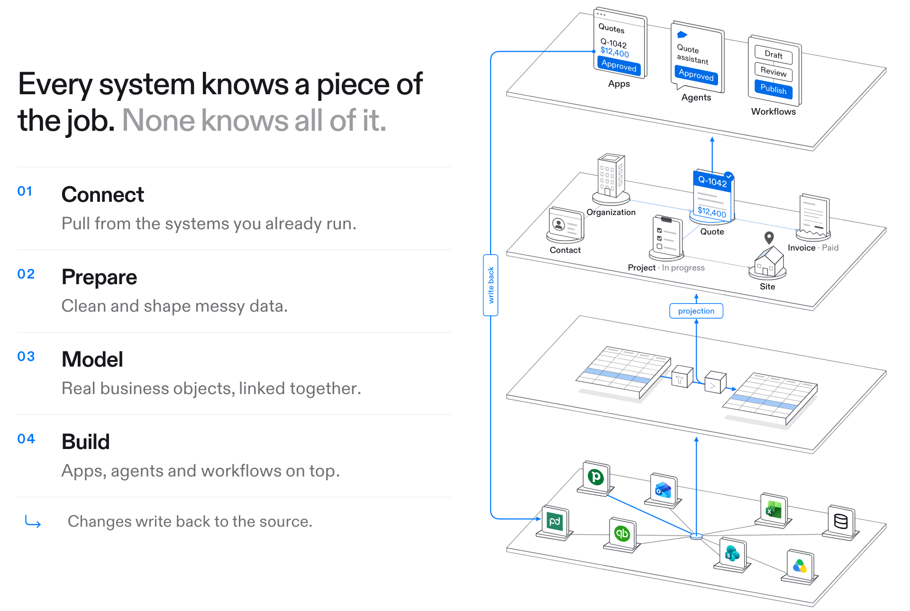

<picture>
  <source media="(prefers-color-scheme: dark)" srcset="docs/brand/sixb-wordmark-white.svg">
  
</picture>

# Model your domain. Put it to work.

A TypeScript framework for ontology-powered apps and AI.

Connect your data, define how it relates and changes, and build apps and AI that work with the same
model.

[**Documentation**](https://docs.sixb.ai) · [Get started](#get-started) ·
[Examples](https://docs.sixb.ai/examples) · [Discord](https://discord.gg/rPSbZSRDzQ)

<picture>
  <source media="(prefers-color-scheme: dark)" srcset="docs/brand/hero-dark.svg">
  
</picture>

## Get started

With [Bun 1.4.2 or later](https://bun.sh/docs/installation):

```bash
bun create sixb my-app
cd my-app
bun install
bun run dev
```

Everything runs locally, with no database to set up and no API keys. Your app opens at
[localhost:3000](http://localhost:3000) and its API reference at
[localhost:3001/docs](http://localhost:3001/docs).

## How it works

<picture>
  <source media="(prefers-color-scheme: dark)" srcset="docs/brand/how-it-works-dark.png">
  
</picture>

Each step maps to folders in your project, which Sixb discovers by convention.

```text
connectors/    01 Connect   the systems you already run
syncs/                      bring their data in
datasets/      02 Prepare   versioned tables
pipelines/                  clean and join them in SQL
ontology/      03 Model     object types and the links between them
projections/                turn rows into objects
actions/       04 Build     typed changes, with write-back to the source
workflows/                  multi-step work, with people in the loop
app/                        your React pages, with the agent built in
```

## Model your domain

Define each thing your business works with once, in TypeScript.

```ts
// ontology/quote.ts
import { defineObjectType, link, prop, stringEnum } from "@sixb/core/ontology"
import { Customer } from "./customer"

export const Quote = defineObjectType({
  id: "Quote",
  name: "Quote",
  properties: [
    prop("id", "string", { required: true, primary: true }),
    prop("amount", "double", { required: true }),
    prop("status", stringEnum(["draft", "sent", "approved"]), {
      required: true,
      query: { searchable: true, filterable: true },
    }),
  ],
  links: [link("customer", Customer, { cardinality: "one" })],
})
```

Then fill it from the systems you already run. A [sync](https://docs.sixb.ai/syncs) brings their
rows into a dataset, and a projection maps those rows onto your type. When the source changes, the
objects follow.

```ts
// projections/quotes.ts
import { defineProjection } from "@sixb/core"
import { crmQuotes } from "../datasets/crm"
import { Customer } from "../ontology/customer"
import { Quote } from "../ontology/quote"

export const quotes = defineProjection("quotes", Quote)
  .fromDataset(crmQuotes)
  .properties({ id: "quote_id", amount: "amount", status: "status" })
  .withLinks({
    customer: { link: Quote.l.customer, sourceField: "customer_id", target: Customer },
  })
```

## Put it to work

Query the model from your app. Its types carry through to the result.

```tsx
// app/quotes/page.tsx
import { useObjectsQuery } from "@sixb/client/hooks"
import { objects } from "@sixb/client/query"
import { Quote } from "../../ontology/quote"

const approved = objects(Quote)
  .query()
  .where((quote) => quote.p.status.eq("approved"))

export default function ApprovedQuotes() {
  const quotes = useObjectsQuery(approved)

  return (
    <ul>
      {quotes.data?.objects.map((quote) => (
        <li key={quote.primaryId}>{quote.properties.amount}</li>
      ))}
    </ul>
  )
}
```

Change it with actions. Each one is typed, checked against the caller's permissions, and can write
back to the system the data came from.

```ts
// actions/approve-quote.ts
import { defineAction } from "@sixb/core"
import { crm } from "../connectors/crm"
import { Quote } from "../ontology/quote"

export const approveQuote = defineAction("approve-quote")
  .on(Quote)
  .params({})
  .writeback(async ({ target, sixb, run }) => {
    const client = await sixb.connector(crm)
    await client.approveQuote(target.primaryId, run.idempotencyKey)
  })
  .edits(({ objects, subject }) => {
    objects(Quote).byId(subject.primaryId).update({ status: "approved" })
  })
```

The built-in [agent](https://docs.sixb.ai/models) works from the same model. It reads your types,
queries live data and requests actions through the [Sixb CLI](https://docs.sixb.ai/cli), in a
sandbox. In chat it has the permissions of the person asking; in a
[workflow](https://docs.sixb.ai/workflows), you decide its access. It runs on the language models
you configure.

## Built in

Every app comes with the pages you need to run it, before you write one of your own:

- **Agent**: ask about your data and get work done, in threads you can share.
- **Ontology**: browse your types, objects, links, actions, workflows and rules.
- **Data**: your connectors, syncs, datasets, pipelines and projections, with every run.
- **Observability**: workflow and action runs, logs, activity and AI usage.
- **Settings**: your profile and tokens, project members and service accounts.

## Example

[Northline Mechanical](examples/northline) is a reference app for a fictional building-services
company. It connects a business system, a field-service platform and building controls around one
model of customers, equipment and service cases.

[Open the app](https://northline.sixb.ai) · [API reference](https://northline.sixb.ai/docs) ·
[Read the code](examples/northline)

---

Sixb is in active development. Releases on the `0.1.x` line can include breaking changes and
database migrations, so read the [changelog](CHANGELOG.md) before upgrading.

[Documentation](https://docs.sixb.ai) · [CLI reference](https://docs.sixb.ai/cli) ·
[Contributing](CONTRIBUTING.md) · [MIT License](LICENSE)

[](https://www.npmjs.com/package/@sixb/core)
[](https://github.com/sixb-ai/sixb/actions/workflows/ci.yml)
