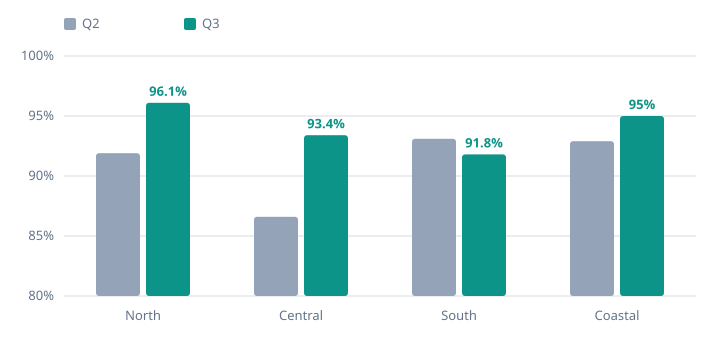

# Q3 operations review

Priority equipment was restored within its service window 94% of the time this quarter, up from 88%,
while parts costs held flat against a 12% rise in calls.

## Restorations within SLA rose in three of four regions

| Region | Visits | Within SLA | Change | Parts cost |
| --- | --- | --- | --- | --- |
| North | 1,284 | 96.1% | +4.2% | $182,400 |
| Central | 962 | 93.4% | +6.8% | $141,950 |
| South | 1,107 | 91.8% | (1.3%) | $166,020 |
| Coastal | 448 | 95.0% | +2.1% | $58,310 |
| **Total** | **3,801** | **94.0%** | **+3.9%** | **$548,680** |

South slipped while two senior technicians were on leave in August and the region absorbed the
Harbor Point failures.

## Parts cost per visit fell from $151 to $144

More repairs used depot stock instead of rush orders. Service revenue grew 9.6% to $2.14M[^revenue].

## Compressor lead times are the main risk

> [!WARNING]
> Compressor lead times have stretched to nine weeks. Three open cases are waiting on parts.

| Site | Issue | Owner | Due |
| --- | --- | --- | --- |
| Harbor Point | Rooftop units RTU-1 and RTU-2 | Dana Ortiz | Oct 31 |
| Central depot | Compressor stock | Sam Patel | Nov 15 |

## Next quarter

- [x] Roll out the dispatch board to every region
- [ ] Stock compressors at the Central depot
- [ ] Certify four more technicians on building controls

[^revenue]: Invoiced service revenue from the business system, excluding parts resold at cost.
